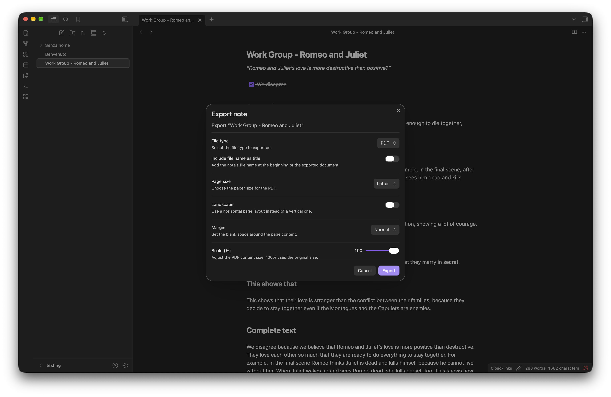
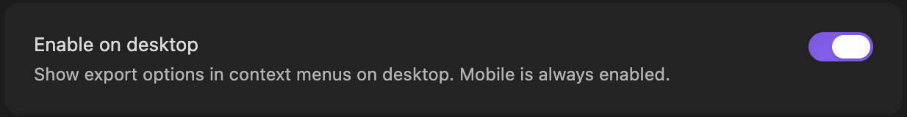

# Mobile Export

Export your Obsidian notes to **PDF** or **HTML**, directly from mobile. Mobile Export creates clean documents that are easy to share, print, or open outside Obsidian.

## Usage

Open the context menu for a note or inside the editor and select **Export file**.
Choose between PDF and HTML. PDF exports can be customized with page size, orientation, margins, text size, and an optional title.

### Bulk export

Select **Export notes** from a folder's context menu, or select multiple notes and folders in the file explorer and choose **Export notes** from their context menu. Choose PDF or HTML with the same PDF options used for a single note. **Include subfolders** controls recursive folder export; explicitly selected notes are always included. Non-Markdown files are ignored and overlapping selections are deduplicated.

Select **Export** to process notes one at a time. The same dialog hides the options during preparation and shows a progress bar with the current note. Options return if preparation is cancelled or fails. On desktop, the ZIP download starts automatically when preparation finishes. **Cancel** stops before the next note and discards the batch. Failed notes are listed in the dialog and a notification; successful notes are still exported.

- **Desktop:** download one ZIP. Enable desktop support in the plugin settings if the menu is hidden.
- **iOS / Android:** share individual files by default. Turn on **Export as a ZIP** to package the notes into one archive instead. Sharing opens automatically after preparation when the device still permits it. If a fresh tap is required by the system, select **Share files** or **Share ZIP** in the same dialog. If the full batch cannot be shared, select **Cancel**, reopen the export dialog, and turn on **Export as a ZIP**. Both modes require native file-sharing support, and destination apps may impose their own file limits.

ZIP archives retain the selected folder as their root. Mixed selections retain vault-relative paths so notes with the same name stay distinct. Individual files shared through the native sheet do not preserve folders.

Exports are prepared locally. The finished ZIP or shared files still occupy memory, so very large batches may exceed the device's available memory. HTML uses the same Obsidian links and resource URLs as a single-note export; ZIP packaging does not make those references self-contained.

## Offline support and external assets

PDF export requires a small additional component that is downloaded from **jsDelivr** the first time you use it.
After that, PDF export works offline. Your notes are never uploaded or sent to any external service.

_The component in question is [Takumi PDF for browser use (WASM)](https://takumi.kane.tw/docs/pdf#in-the-browser), the current downloaded version is `0.15.0`_

## Desktop

Mobile Export also works on desktop. If you only want to use it on mobile, you can disable desktop support from **Settings → Community plugins → Mobile Export**.

## Language Support

Mobile Export supports all languages that are supported by Obsidian. Please report any issues with your language to the [GitHub repository](https://github.com/clemenzi/obsidian-mobile-export/issues).

## License

See [LICENSE](./LICENSE).
